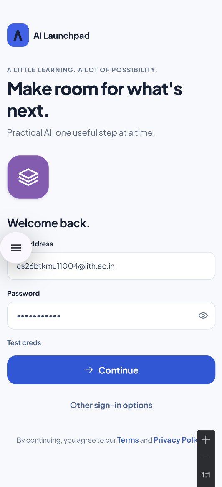
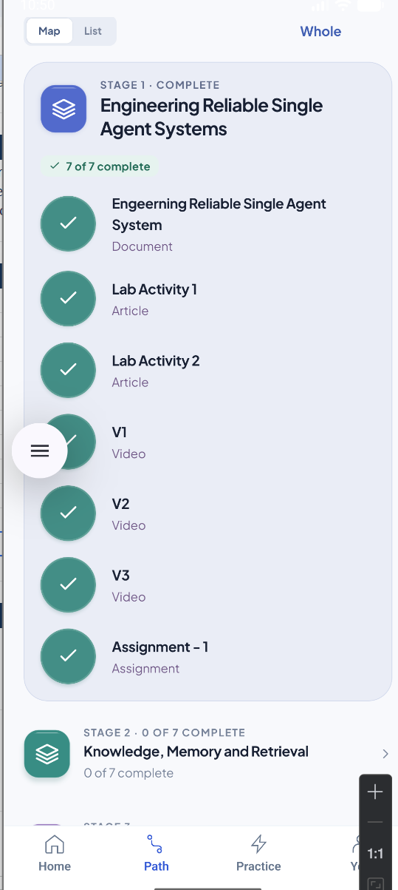
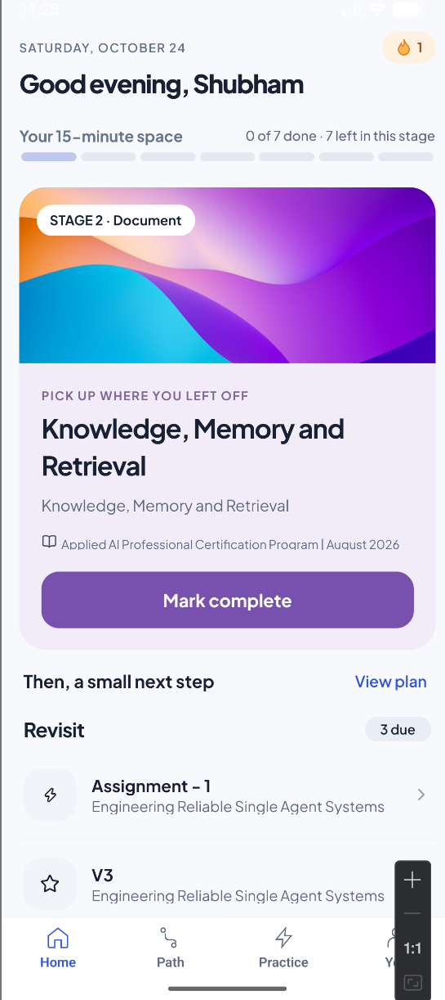
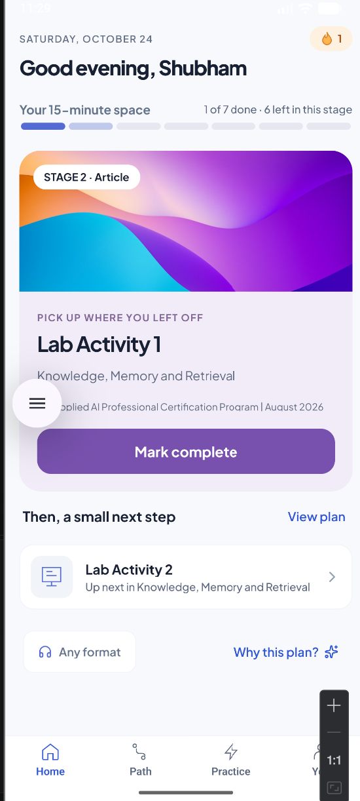
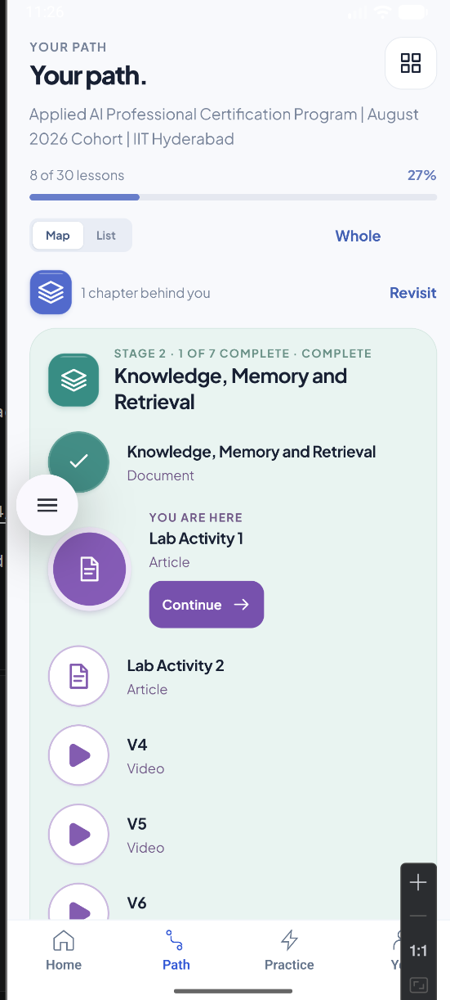
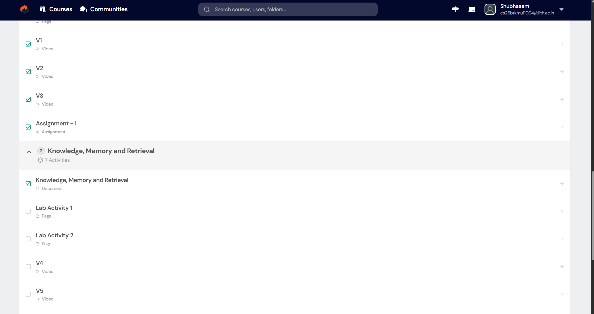

# Live run and review-fix evidence — 24 Oct 2026

Owner: Shubham · Branch: `integrate/org-bff` · Code under test: commit `ba0b492` (and its parents)

This file separates three kinds of evidence, as the W3 review asked:

- **Live run**: the Android app against the real LearnHouse instance, through the BFF. Screenshots and BFF log lines below.
- **Automated, fake-backed**: BFF tests against an in-memory LearnHouse double (`bff/test/fakeLearnHouse.ts`). They prove BFF logic, not LearnHouse's routes.
- **Automated, adapter-level**: tests that pin the exact LearnHouse URLs, methods and headers the adapter sends (`bff/test/learnhouse.test.ts`).

Nothing below is a claim from memory: each item points at a screenshot, a log excerpt or a raw output file in `docs/evidence/`.

---

## 1. Environment

| Item | Value |
|---|---|
| Date | 24 Oct 2026 |
| App | Expo SDK 57, React Native 0.86.3, development build (`npx expo run:android`) |
| Device | Android emulator "Medium_Phone" (x86_64) |
| BFF | Node 22.19 on Windows, `npm start` (tsx), `http://10.0.2.2:3000/api` from the emulator |
| LearnHouse | Team's self-hosted fork of open-source LearnHouse at `learn.praxisacademy.ai` (Docker; Next.js 16.3.2 web frontend; PostgreSQL). Exact release/commit: **pending from the server admin** (public `/openapi.json` is disabled; my account has no Docker access). |
| Login mode | Real LearnHouse login (`POST /api/auth/login` → LearnHouse `/auth/login`; no DEV LOGIN warning at BFF start) |
| Course | Applied AI Professional Certification Program \| August 2026 Cohort (only course allow-listed in `bff/.env`; 30 activities) |
| Agent model | `gemini-3.5-flash-lite` (BFF startup line) |

## 2. Live run: login → Home → complete → read-back

Screenshots are in `docs/evidence/live-2026-10-24/`. Run on 24 Oct 2026 (~17:50–18:00 IST), one learner (the author's own LearnHouse account).

| # | Step | Observed | Screenshot |
|---|---|---|---|
| 1 | Sign in | Real LearnHouse account; password masked. "Test creds" link visible because this is a `__DEV__` build |  |
| 2 | Path before | Stage 1 "Engineering Reliable Single Agent Systems" 7 of 7 complete; Stage 2 "Knowledge, Memory and Retrieval" 0 of 7 |  |
| 3 | Home before | Header from real progress (streak 1, "0 of 7 done · 7 left in this stage"). Agent card: **STAGE 2 · Document**, "Knowledge, Memory and Retrieval", course as meta line, Mark complete. Next-step slot: the agent chose **RevisitSection** (3 due: Assignment - 1, V3, …) |  |
| 4 | Mark complete | `POST …/complete 200` in the BFF log (applied after read-back). No separate screenshot of the "Progress saved." notice | — |
| 5 | Home after | Card moved to the next activity: **STAGE 2 · Article**, "Lab Activity 1"; header "1 of 7 done · 6 left in this stage"; next step "Lab Activity 2" |  |
| 6 | Path after | "Knowledge, Memory and Retrieval" ticked; "You are here: Lab Activity 1"; course 8 of 30 lessons (27%) |  |
| 7 | LearnHouse website | Same learner on the LearnHouse web app: "Knowledge, Memory and Retrieval" ticked, Lab Activity 1/2 not — **cross-client read-back of the app's write** |  |

### BFF log for the run

As printed by the BFF (method, route pattern, status, time; no bodies, headers or tokens):

```text
LearnHouse: https://learn.praxisacademy.ai/api/v1 org=default courses=1 token=set agent=gemini-3.5-flash-lite
BFF listening on http://localhost:3000
GET /api/me 401 4ms
POST /api/auth/login 200 1485ms
GET /api/me 200 1ms
GET /api/me/trail 200 1034ms
[agent] decision: HomeCard + NextStepCard
[home-layout] source=agent mainCard=HomeCard nextStep=NextStepCard
GET /api/me/courses/:courseUuid/home-layout 200 9405ms
POST /api/me/courses/:courseUuid/activities/:activityUuid/complete 200 3055ms
GET /api/me/trail 200 427ms
[agent] fallback used: gemini_http_503
[home-layout] source=fallback mainCard=HomeCard nextStep=NextStepCard
GET /api/me/courses/:courseUuid/home-layout 200 5069ms
GET /api/me/trail 200 968ms
[agent] decision: HomeCard + RevisitSection
[home-layout] source=agent mainCard=HomeCard nextStep=RevisitSection
GET /api/me/courses/:courseUuid/home-layout 200 8254ms
[agent] decision: HomeCard + NextStepCard
[home-layout] source=agent mainCard=HomeCard nextStep=NextStepCard
GET /api/me/courses/:courseUuid/home-layout 200 8714ms
GET /api/me/trail 200 712ms
[agent] decision: HomeCard + NextStepCard
[home-layout] source=agent mainCard=HomeCard nextStep=NextStepCard
GET /api/me/courses/:courseUuid/home-layout 200 4846ms
[agent] decision: HomeCard + NextStepCard
[home-layout] source=agent mainCard=HomeCard nextStep=NextStepCard
GET /api/me/courses/:courseUuid/home-layout 200 8060ms
```

**Result: pass.** Real login → session → progress read → agent layout → completion write → read-back on both the app and the LearnHouse website.

What the log also shows:

- **Graceful agent failure, live.** One Gemini call returned HTTP 503; the BFF logged `fallback used: gemini_http_503` (a code, no model text: W3 fix 1) and served the deterministic layout. The learner saw a normal card.
- **The agent's choice changed with progress**: before the completion it chose `HomeCard + RevisitSection`, afterwards `HomeCard + NextStepCard`.
- **The first `GET /api/me 401` is expected**: the app re-validates a stored session at start-up, and BFF sessions are in memory, so they don't survive a BFF restart.
- **Latency (input for M9).** `home-layout` took **4.8–9.4 s**, almost all of it the Gemini call; the app's layout deadline is 10 s, so the slowest run nearly fell back. `/me/trail` 0.4–1.0 s; login 1.5 s; completion 3.1 s (write + read-back). This is the main reason for M6: stream the deterministic layout first, then apply the agent's choice when it arrives.

Issues seen, not fixed in this run:

- Path, current stage header reads "STAGE 2 · 1 OF 7 COMPLETE · COMPLETE": the trailing "COMPLETE" is wrong for an in-progress stage (org Path component).
- The Home card for "Knowledge, Memory and Retrieval" shows the same text as title and subtitle, because that activity has the same name as its chapter (content, not code).
- Format names differ from the website for rich pages: LearnHouse shows "Page", the app shows "Article" (`TYPE_DYNAMIC`).

### Before this run: the completion route was wrong

The first live "Mark complete" returned `404` from LearnHouse. The adapter posted to `/admin/{org}/trails/{user}/activities/{id}/complete`; the [headless API reference](https://docs.learnhouse.app/reference/headless) puts completion at `/admin/{org}/progress/{user}/activities/{id}/complete` (`/trails` is only the progress read). Fixed in `9779076`, pinned by the adapter test `adapter: complete activity -> POST /admin/{org}/progress/...`.

## 3. What the app holds (secret placement)

- The app calls only the BFF (`EXPO_PUBLIC_BFF_URL`). `grep -rn "EXPO_PUBLIC_LEARNHOUSE|ADMIN_TOKEN|lh_" src App.tsx app.json` (excluding tests) returns **0** matches on `ba0b492`. The org branch's `adminToken.ts` (org API token in the bundle) was removed in the merge.
- SecureStore holds only the opaque BFF session token; the legacy LearnHouse JWT key is deleted on sign-out.
- The local profile (SQLite) stores onboarding answers, no password or password hash; hashes from older builds are wiped (`localProfileDb.test.ts`: "wipes password hashes that older builds stored").
- The org API token and Gemini key exist only in `bff/.env` (not tracked).
- Still in the dev bundle: `EXPO_PUBLIC_TEST_LOGIN_EMAIL/PASSWORD` for the `__DEV__`-only "Test creds" button. Throwaway test account only.

## 4. W3 review findings closed today

Each new test **fails on the previous code and passes now** (checked by running it against the old `app.ts`).

| W3 finding | Fix | Test (in `bff/test/`) | Commit |
|---|---|---|---|
| Malformed model JSON: the BFF warning quoted model output | Fixed reason codes (`malformed_json`, `timeout`, `gemini_http_<n>`, …) | `malformed model JSON -> fallback, and the log carries a reason code, not model text`; `agentFailureCode: fixed codes for each failure class` | `92ff150` |
| Malformed %-encoded route left unanswered (URIError outside try/catch) | 400 `bad_request` | `malformed percent-encoding in a route param -> 400, and the server keeps serving` | `92ff150` |
| Concurrent same-key requests each wrote upstream | Key reserved while its write runs | `concurrent requests with the same Idempotency-Key -> exactly one upstream write, same result` | `92ff150` |
| Key bound to activity only; replay under another course | Key bound to learner + course + activity | `same key reused for the same activity in another course -> 409 before any upstream call` | `92ff150` |
| Allow-list ≠ entitlement; not-enrolled learner got a write and an actionable card | Enrollment check before any write; no write target in the layout | `not-enrolled learner: completion -> 403 not_enrolled and no upstream write`; `not-enrolled learner: home-layout still works, but offers no completion target` | `92ff150` |
| Missing `published` treated as published | Only an explicit flag publishes (meta, else the learner's trail) | `activity with no published flag is not published (no card, no write); the trail flag can publish it` | `92ff150` |
| Unknown server component / 24-char contract cap vs 40-char BFF clip | Contract `category`/`stage` 40 chars; BFF slots typed with the client contract; contract test parses every agent choice | `contract: every agent choice produces slots the client accepts`; `contract: long course and chapter names ... still give a valid HomeCard` | `81fbaa0` |
| Fake bypasses the HTTP routes | Adapter tests pin real URLs/methods/headers | `adapter: …` (8 tests) | `9779076`, `dbbcbcd` |
| Hard-coded streak 12 / "2 of 6" / "~12 min" on Home | Header, streak and stage progress from LearnHouse progress (org `useHomeData`) | org `useHomeData.test.tsx` | `dbbcbcd` |

## 5. Automated results (raw output in this folder)

| Suite | Result | Raw output |
|---|---|---|
| BFF (node:test via tsx) | **54 / 54 pass** | `bff-tests.txt` |
| BFF typecheck (`tsc -p bff`, strict) | clean | `typecheck-bff.txt` |
| App typecheck (`tsc --noEmit`) | clean on `dbbcbcd`; [rerun: `npm run typecheck`] | [paste] |
| App Jest (`npm test`) | **pending**: run on Windows and paste the summary | `jest.txt` |

## 6. Activity content (input for the M4 lesson player)

Output of `npx tsx --env-file=.env scripts/diagnose.ts EMAIL "PASSWORD"` step 6 (field names only, no values):

```text

[6a course meta WITHOUT slim (org token)] GET /courses/course_4b5b0899-6408-462f-982c-1dbebd43b148/meta
  status: 200
  activities: 30; by type: {"TYPE_DOCUMENT/SUBTYPE_DOCUMENT_PDF":6,"TYPE_DYNAMIC/SUBTYPE_DYNAMIC_PAGE":8,"TYPE_VIDEO/SUBTYPE_VIDEO_YOUTUBE":12,"TYPE_ASSIGNMENT/SUBTYPE_ASSIGNMENT_ANY":4}
  first video (or given) activity in meta: {"activity_uuid":"activity_7ea631f1-9ade-4c31-9230-97d8c5899d80","activity_type":"TYPE_VIDEO","activity_sub_type":"SUBTYPE_VIDEO_YOUTUBE","published":true,"content_keys":["uri","type","activity_uuid"],"content_type":"youtube","details_keys":["startTime","endTime","autoplay","muted"]}

[6b single activity (org token)] GET /activities/activity_7ea631f1-9ade-4c31-9230-97d8c5899d80
  status: 200
  GET /activities/{uuid}: {"activity_uuid":"activity_7ea631f1-9ade-4c31-9230-97d8c5899d80","activity_type":"TYPE_VIDEO","activity_sub_type":"SUBTYPE_VIDEO_YOUTUBE","published":true,"content_keys":["uri","type","activity_uuid"],"content_type":"youtube","details_keys":["startTime","endTime","autoplay","muted"]}

[1 login] POST /auth/login
  status: 200
  user id found: 51   user token present: yes

[2 course meta (org token)] GET /courses/course_4b5b0899-6408-462f-982c-1dbebd43b148/meta?slim=true
  status: 200

[3 course meta (user token)] GET /courses/course_4b5b0899-6408-462f-982c-1dbebd43b148/meta?slim=true
  status: 200

[4 trail (org token)] GET /admin/default/trails/<id>/courses/course_4b5b0899-6408-462f-982c-1dbebd43b148
  status: 200

[5 my orgs (user token) — to confirm the org slug] GET /orgs/user/page/1/limit/10
  status: 200
```

## 7. Not done yet (stated plainly)

- **M4** checkpoint player: not started. Course video "V1" is a YouTube activity (`content.uri`, `content.type: "youtube"`), so it needs the YouTube iframe player; offline playback needs one hosted video.
- **M5** durable offline sync: idempotency is still in memory (a BFF restart forgets keys; LearnHouse completion is idempotent, so a forgotten key cannot double-complete). No client outbox yet.
- **M6** streamed agent protocol and approval: not started (layout is one-shot).
- **M3** independently deployed web modules, **M8** accessibility tests, **M9** measurements: not started.
- Google sign-in: BFF route and adapter done and tested; the app's Google SDK is still a stub (no OAuth client IDs).
